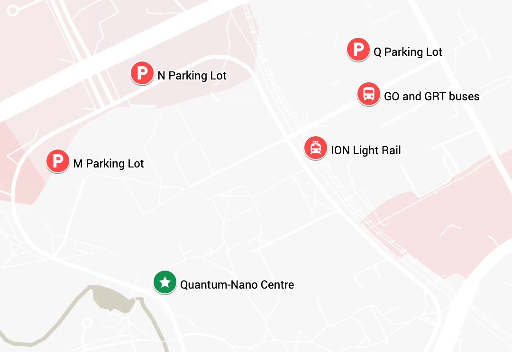
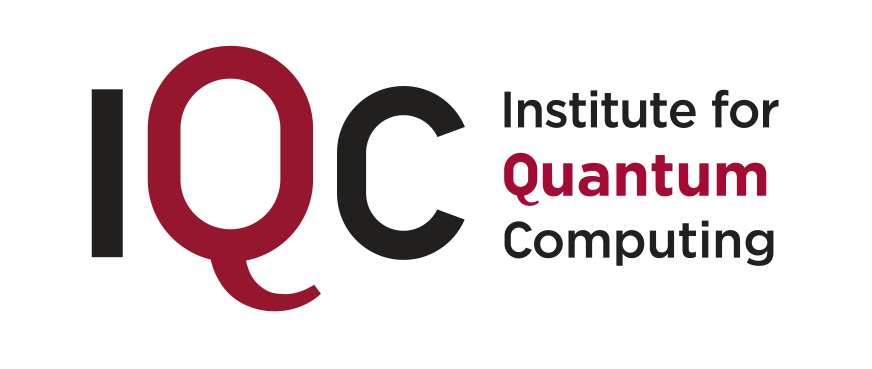
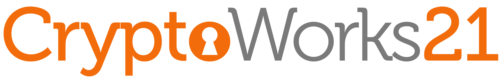

**Ontario Cryptography Day** is a recurring event that aims to bring together the cryptography community in Ontario for a day of research talks and discussions.

The event is open to academic, industry, and public sector researchers and practitioners in cryptography, but registration is required.



<h2>Program</h2>

Our invited keynote speaker will be <a href="https://people.eecs.berkeley.edu/~sanjamg/"><b>Sanjam Garg</b></a> from UC Berkeley.

Our other invited speakers will be:

<ul>
<li><a href="https://andrejb.net/"><b>Andrej Bogdanov</b></a>, University of Ottawa</li>
<li><a href="https://jonasjanneck.org/"><b>Jonas Janneck</b></a>, University of Waterloo</li>
<li><b>Shane Kelly</b>, DigiCert</li>
<li><b>Ratnakar Medepalli</b>, Tata Institute of Fundamental Research  <i>Round-optimal black-box MPC in the plain model from minimal assumptions</i></li>
<!-- Abstract: One of the salient measures of complexity of secure multiparty computation (MPC) protocols is the number of rounds of communication required. We are especially interested in the case of black-box MPC protocols i.e. those that use their constituent building blocks as oracles, as such protocols tend to have better concrete efficiency. In this work, we study the exact round complexity of black box MPC protocols that are constructed from minimal assumptions.
Previous works showed that at least four rounds are necessary to compute non-trivial functionalities, and five rounds are required for constructions that make black-box use of a 4-round oblivious transfer (OT). We show that five rounds are sufficient to construct a black-box protocol if we start with an OT that satisfies a natural property called 'receiver commitment', and also obtain a matching lower bound.
Based on joint work with Mohammad Hajiabadi and Akshayaram Srinivasan.
-->
</ul>

Lunch and coffee breaks will be included.

<!-- TODO: replace with the program table once speakers are confirmed, e.g.

<table class="program-table">
<tr>
  <td>09:40–10:00</td>
  <td>QNC&nbsp;0101</td>
  <td>Registration</td>
</tr>
</table>

-->

## Travel

**Location:** [Mike & Ophelia Lazaridis Quantum-Nano Centre (QNC)](https://maps.app.goo.gl/3P1JhtvBLKHhwLQR9), 200 University Avenue West, Waterloo, Ontario, room QNC 0101.

**Parking:** The closest visitor parking lots to the Quantum-Nano Centre are [Lot M](https://maps.app.goo.gl/pa3bmnyLBW3S3Nd67), [Lot N](https://maps.app.goo.gl/Ew65JkcPTafPj79S6), and [Lot Q](https://maps.app.goo.gl/KCtv98mu2kJUTwYa9), which cost about $10–$12/day and must be paid using the [AMP Mobile pay app](https://uwaterloo.ca/sustainable-transportation/visitors). See the University of Waterloo's [visitor parking information](https://uwaterloo.ca/sustainable-transportation/visitors) for more details.

**Public transport:**

- [GO Transit](https://www.gotransit.com/en): Some GO Transit buses come directly to campus, and GO trains to Kitchener station connect with GRT buses/light rail from Kitchener to the university. Check the trip planner on the GO Transit website for more details.
- [Grand River Transit](https://www.grt.ca/en/): The ION light rail stops at the [University of Waterloo station](https://maps.app.goo.gl/pAdNsNZxX9tB7FN17), a short walk from QNC. There are also many local buses that reach the University of Waterloo campus.

## Map

## Organizers

- [Mohammad Hajiabadi](https://sites.google.com/view/mdhajiabadi/home), University of Waterloo
- [Sam Jaques](https://sam-jaques.appspot.com/), University of Waterloo
- [Douglas Stebila](https://www.douglas.stebila.ca/research/), University of Waterloo

For more information, please email [dstebila@uwaterloo.ca](mailto:dstebila@uwaterloo.ca).

## Sponsors

Ontario Cryptography Day is made possible with the financial support of the University of Waterloo's [Institute for Quantum Computing](https://uwaterloo.ca/institute-for-quantum-computing) and the University of Waterloo's [CryptoWorks21 program](https://uwaterloo.ca/cryptoworks/).

