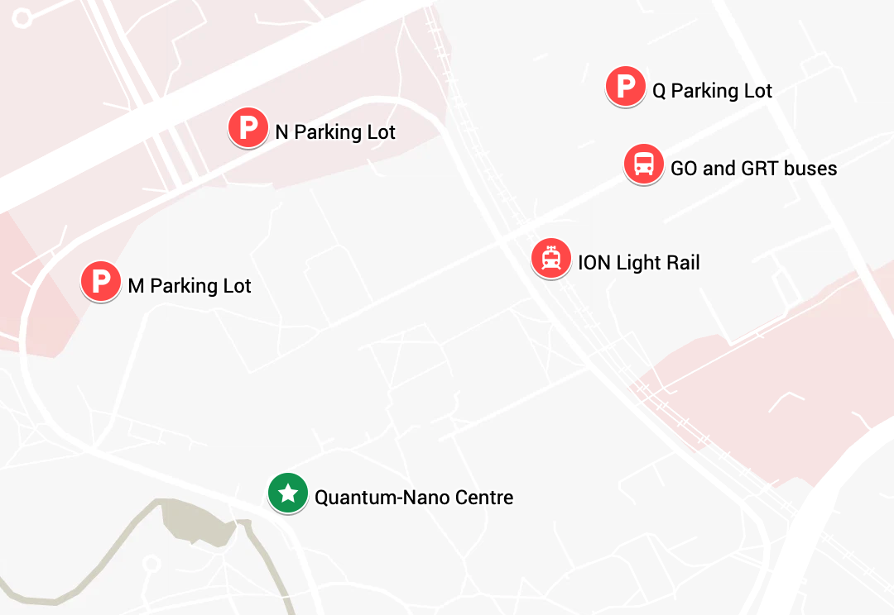
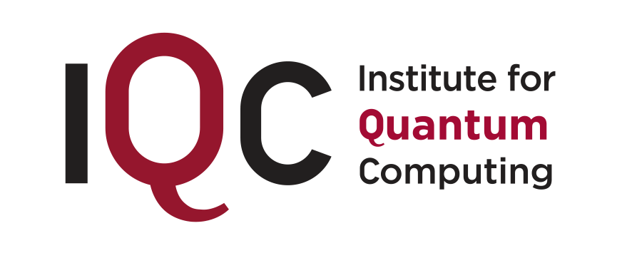
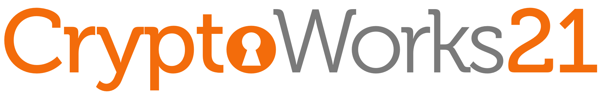

**Ontario Cryptography Day** is a recurring event that aims to bring together the cryptography community in Ontario for a day of research talks and discussions.

The event is open to academic, industry, and public sector researchers and practitioners in cryptography, but registration is required.



<h2>Program</h2>
<table class="program-table">
<tr>
  <td>09:40–10:00</td>
  <td></td>
  <td>Registration</td>
</tr>

<tr>
  <td>10:00–10:45</td>
  <td></td>
  <td><b><a target="_blank" href="https://andrejb.net/">Andrej Bogdanov</a></b>, University of Ottawa. 
  <i>My favorite open problem in secret sharing</i>
  

  
Abstract

    A bit of information is shared among Alice, Bob, Carol, Dave, Elsa, Fred and Gina. Any three of them can recover it. Any two know nothing about it. In 1979 Shamir showed how to do this, as long as each can spare three bits of memory. What if they are a little short? I will tell you about the circuitous route from “P equals NP” to this question, its relation to Csirmaz’s mysterious duality conjecture, and some recent insights from joint work with Yanbo Chen.
  

  </td>
</tr>

<tr>
  <td>10:45–11:15</td>
  <td></td>
  <td>Coffee break</td>
</tr>

<tr>
  <td>11:15–12:15</td>
  <td></td>
  <td>Invited keynote: <b><a target="_blank" href="https://people.eecs.berkeley.edu/~sanjamg/">Sanjam Garg</a></b>, UC Berkeley.
  </td>
</tr>

<tr>
  <td>12:15–13:45</td>
  <td></td>
  <td>Lunch</td>
</tr>

<tr>
  <td>13:45–14:30</td>
  <td></td>
  <td><b>Shane Kelly</b>, DigiCert. 
  <i>From Leaf to Root: A Merkle Tree Certificate Talk</i>
  

  
Abstract

    This talk will cover Merkle Tree Certificates (MTCs) from the ground up. We'll start with an overview of why we're talking about them then dive right into the underlying data structures and algorithms. We'll top it off with discussion of how this affects PKI infrastructure and cover a couple open MTC related questions.
  

  </td>
</tr>

<tr>
  <td>14:30–15:15</td>
  <td></td>
  <td><b>Ratnakar Medepalli</b>, Tata Institute of Fundamental Research (research visitor University of Toronto). 
  <i>Round-optimal black-box MPC in the plain model from minimal assumptions</i>
  

  
Abstract

    One of the salient measures of complexity of secure multiparty computation (MPC) protocols is the number of rounds of communication required. We are especially interested in the case of black-box MPC protocols i.e. those that use their constituent building blocks as oracles, as such protocols tend to have better concrete efficiency. In this work, we study the exact round complexity of black box MPC protocols that are constructed from minimal assumptions.Previous works showed that at least four rounds are necessary to compute non-trivial functionalities, and five rounds are required for constructions that make black-box use of a 4-round oblivious transfer (OT). We show that five rounds are sufficient to construct a black-box protocol if we start with an OT that satisfies a natural property called 'receiver commitment', and also obtain a matching lower bound. Based on joint work with Mohammad Hajiabadi and Akshayaram Srinivasan.
  

  </td>
</tr>

<tr>
  <td>15:15–15:45</td>
  <td></td>
  <td>Coffee break</td>
</tr>

<tr>
  <td>15:45–16:30</td>
  <td></td>
  <td><b><a target="_blank" href="https://jonasjanneck.org/">Jonas Janneck</a></b>, University of Waterloo. 
  <i>Signature combiners and strong unforgeability</i>
  

  
Abstract

    The transition to post-quantum cryptography is mostly realized through a hybrid approach, in which algorithms based on classical hardness assumptions, such as the discrete logarithm problem, are combined with post-quantum algorithms that rely on quantum-resistant assumptions, such as the Short Integer Solution problem. In this talk, I will give an overview of combiners for signature schemes and their security properties. A special focus will be placed on achieving strong unforgeability and the reasons why previous combiners failed to preserve it. Then, I will present three practical combiners preserving strong unforgeability as well as additional properties. This talk is based on "<a href="https://eprint.iacr.org/2025/1844">Bird of Prey: Practical Signature Combiners Preserving Strong Unforgeability</a>" from Eurocrypt’26.
  

  </td>
</tr>

</table>

## Travel

**Location:** [Mike & Ophelia Lazaridis Quantum-Nano Centre (QNC)](https://maps.app.goo.gl/3P1JhtvBLKHhwLQR9), 200 University Avenue West, Waterloo, Ontario, room QNC 0101.

**Parking:** The closest visitor parking lots to the Quantum-Nano Centre are [Lot M](https://maps.app.goo.gl/pa3bmnyLBW3S3Nd67), [Lot N](https://maps.app.goo.gl/Ew65JkcPTafPj79S6), and [Lot Q](https://maps.app.goo.gl/KCtv98mu2kJUTwYa9), which cost about $10–$12/day and must be paid using the [AMP Mobile pay app](https://uwaterloo.ca/sustainable-transportation/visitors). See the University of Waterloo's [visitor parking information](https://uwaterloo.ca/sustainable-transportation/visitors) for more details.

**Public transport:**

- [GO Transit](https://www.gotransit.com/en): Some GO Transit buses come directly to campus, and GO trains to Kitchener station connect with GRT buses/light rail from Kitchener to the university. Check the trip planner on the GO Transit website for more details.
- [Grand River Transit](https://www.grt.ca/en/): The ION light rail stops at the [University of Waterloo station](https://maps.app.goo.gl/pAdNsNZxX9tB7FN17), a short walk from QNC. There are also many local buses that reach the University of Waterloo campus.

## Map

## Organizers

- [Mohammad Hajiabadi](https://sites.google.com/view/mdhajiabadi/home), University of Waterloo
- [Sam Jaques](https://sam-jaques.appspot.com/), University of Waterloo
- [Douglas Stebila](https://www.douglas.stebila.ca/research/), University of Waterloo

For more information, please email [dstebila@uwaterloo.ca](mailto:dstebila@uwaterloo.ca).

## Sponsors

Ontario Cryptography Day is made possible with the financial support of the University of Waterloo's [Institute for Quantum Computing](https://uwaterloo.ca/institute-for-quantum-computing) and the University of Waterloo's [CryptoWorks21 program](https://uwaterloo.ca/cryptoworks/).

