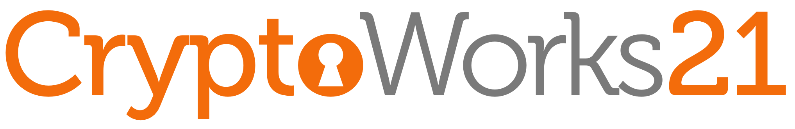

**Ontario Cryptography Day** is a recurring event that aims to bring together the cryptography community in Ontario for a day of research talks and discussions.

The event is open to academic, industry, and public sector researchers and practitioners in cryptography, but registration is required.



<h2>Program</h2>

The program will be announced closer to the event.

<!-- TODO: replace with the program table once speakers are confirmed, e.g.

<table class="program-table">
<tr>
  <td>09:40–10:00</td>
  <td>QNC&nbsp;0101</td>
  <td>Registration</td>
</tr>
</table>

-->

## Travel

Travel and parking details will be posted closer to the event.

**Location:** [Mike & Ophelia Lazaridis Quantum-Nano Centre (QNC)](https://maps.app.goo.gl/3P1JhtvBLKHhwLQR9), 200 University Avenue West, Waterloo, Ontario, room QNC 0101.

**Parking:** See the University of Waterloo's [visitor parking information](https://uwaterloo.ca/sustainable-transportation/visitors); visitor lots must be paid using the AMP Mobile pay app.

**Public transport:**

- [GO Transit](https://www.gotransit.com/en): Some GO Transit buses come directly to campus, and GO trains to Kitchener station connect with GRT buses/light rail from Kitchener to UW. Check the trip planner on the GO Transit website for more details.
- [Grand River Transit](https://www.grt.ca/en/): The ION light rail stops at the [University of Waterloo station](https://maps.app.goo.gl/pAdNsNZxX9tB7FN17), a short walk from QNC. There are also many local buses that reach the University of Waterloo campus.

## Map

<iframe src="https://www.google.com/maps/embed?pb=!1m18!1m12!1m3!1d2895.492412476413!2d-80.5465935226207!3d43.471193164181834!2m3!1f0!2f0!3f0!3m2!1i1024!2i768!4f13.1!3m3!1m2!1s0x882bf6aa030140c1%3A0x1bc6d1d3667b8e16!2sMike%20%26%20Ophelia%20Lazaridis%20Quantum-Nano%20Centre%20(QNC)!5e0!3m2!1sen!2sca!4v1785168660570!5m2!1sen!2sca" width="600" height="450" style="border:0;" allowfullscreen="" loading="lazy" referrerpolicy="strict-origin-when-cross-origin"></iframe>

## Organizers

- [Mohammad Hajiabadi](https://sites.google.com/view/mdhajiabadi/home), University of Waterloo
- [Sam Jaques](https://sam-jaques.appspot.com/), University of Waterloo
- [Douglas Stebila](https://www.douglas.stebila.ca/research/), University of Waterloo

For more information, please email [dstebila@uwaterloo.ca](mailto:dstebila@uwaterloo.ca).

## Sponsors

Ontario Cryptography Day is made possible with the financial support of the University of Waterloo's [Institute for Quantum Computing](https://uwaterloo.ca/institute-for-quantum-computing) and the University of Waterloo's [CryptoWorks21 program](https://uwaterloo.ca/cryptoworks/).

